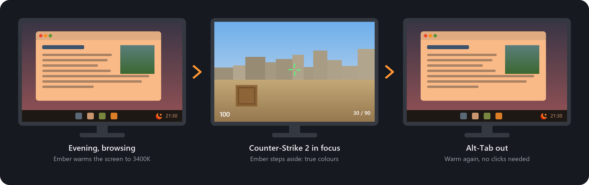
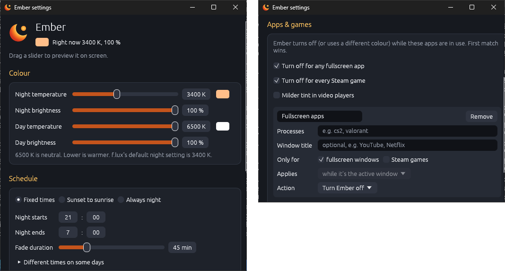

<p align="center">
  
</p>

<h1 align="center">Ember</h1>

<p align="center">
  <b>A warm screen at night, true colours the moment you tab into a game.</b><br>
  A free, open-source alternative to f.lux for Windows and Linux.
</p>

<p align="center">
  <a href="#windows-10-and-11"></a>
  <a href="#linux"></a>
  <br>
  <a href="https://github.com/fredagsguf/Ember/releases/latest"></a>
</p>

<p align="center">
  <a href="LICENSE"></a>
</p>

<p align="center">
  
</p>

## Why Ember?

Warm, dim light in the evening is easier on the eyes and on your sleep. That's why f.lux and Windows Night Light exist. But the moment you launch a game, that orange filter is in the way: enemies blend into the background, colours look wrong, and you end up switching the whole thing off by hand and forgetting to turn it back on.

**Ember knows what you're looking at.** Tell it once that Counter-Strike 2 (or any app) should get true colours, and it switches off the instant the game has focus and warms back up when you tab out. No hotkeys, no remembering.

## Features

- **Per-app rules.** Turn Ember off, or use a different colour, while a specific app is focused or simply running. Add one in two clicks from the tray: open the game, click the tray icon, tick *Disable while "cs2" is focused*.
- **No setup for games.** One tick in Settings turns Ember off for any fullscreen app, or for every game started by Steam. Rules can also match the window title, such as YouTube or Netflix in your browser, and there's a ready-made milder tint for video players.
- **Follows the sun or your clock.** Warm up at sunset and back at sunrise for your city (shifted earlier or later if you like), or pick fixed times, with later nights on the weekend. An optional bedtime goes warmer still late at night. Every change fades in gently, also when you start your PC in the evening or wake it from sleep. Hover over the tray icon to see when the next change starts.
- **Settings one click away.** Click the tray icon and the settings window opens right above it. Drag a slider and your screen shows that exact colour while you hold it.
- **Pause when you need to.** Disable for 15 minutes, an hour or three hours, or until you switch it back on. Press **Ctrl+Alt+End** from any app to pause or resume (you can change the hotkey in Settings).
- **Respects your calibration.** If your monitor is colour-calibrated, Ember tints on top of your calibration curve and puts it back when it steps aside, instead of wiping it.
- **Per-monitor control.** Got a calibrated screen for photo editing? Untick it under *Displays* in Settings and Ember leaves it alone while it warms up the others.
- **Windows and Linux.** Windows 10/11, any Linux desktop on X11, and Wayland on sway, Hyprland and other wlroots compositors or KDE Plasma.
- **Light and private.** One small program with no installer and no runtime. Ember never connects to the internet: sunset times are calculated on your PC.
- **Free and open source** under the MIT license.

## Get Ember

### Windows 10 and 11

1. Download the latest `ember-vX.Y.Z-windows-x64.zip` from **[Releases](https://github.com/fredagsguf/Ember/releases/latest)**.
2. Extract it anywhere (for example `%LOCALAPPDATA%\Programs\Ember`). Run it from there, not from inside the zip.
3. Run **`ember.exe`**. Ember sits in the system tray; Windows 11 may tuck new icons behind the **^** arrow next to the clock, so drag it onto the taskbar to keep it visible.
4. Optional: tick **Start with Windows** in the tray menu.

`ember.exe` isn't code-signed yet, so the first launch shows *"Windows protected your PC"*. Click **More info → Run anyway**. Each release has a `.sha256` file you can check with `Get-FileHash`.

**Warm colours stop at ~4000K?** Windows limits how warm apps can make the screen until a setting is changed (f.lux changes the same one). When Ember runs into the limit, the tray menu shows **Allow warmer colours…**; it asks for admin rights once, then sign out and back in. It's also under Settings → Advanced. To do it by hand, run `reg add "HKLM\SOFTWARE\Microsoft\Windows NT\CurrentVersion\ICM" /v GdiIcmGammaRange /t REG_DWORD /d 256 /f` in an admin terminal.

### Linux

Download the latest `ember-vX.Y.Z-linux-x64.tar.gz` from **[Releases](https://github.com/fredagsguf/Ember/releases/latest)** and install it for your user. It's built for x86-64 and runs on any distro with glibc 2.35 or newer (Ubuntu 22.04+, Debian 12+, Fedora 36+, Arch…). Linux packages are published from v0.1.2 on.

```bash
tar -xzf ember-v*-linux-x64.tar.gz
cd ember-v*-linux-x64
install -Dm755 ember ~/.local/bin/ember
install -Dm644 ember.desktop ~/.local/share/applications/ember.desktop
install -Dm644 ember.png ~/.local/share/icons/hicolor/512x512/apps/ember.png
ember
```

Or build it from source with [Rust](https://rustup.rs): `cargo install --git https://github.com/fredagsguf/Ember`.

Ember needs a StatusNotifierItem tray, which KDE, XFCE, Cinnamon, LXQt and waybar have built in. On GNOME, install the *AppIndicator and KStatusNotifierItem Support* extension. The settings window needs OpenGL and `libxkbcommon-x11`, which any normal desktop install has.

What works depends on your session. Ember picks the right method by itself, and the tray shows an error if your desktop isn't supported:

| Session | How Ember changes the colours | "Focused" rules match | Toggle hotkey | Notes |
|---|---|---|---|---|
| X11, any desktop | RandR gamma ramps | process name | ✓ | Everything works |
| Wayland: sway, Hyprland, river, Wayfire, labwc and other wlroots compositors | `wlr-gamma-control` | the window's **app_id** | Hyprland ✓, not sway | Only one program can own the gamma, so quit gammastep/wlsunset first |
| Wayland: KDE Plasma 5.18+ | KDE's own Night Light | process name | Plasma 6 ✓ | See below |
| Wayland: GNOME | not possible | — | — | GNOME doesn't let apps change the colours; use its built-in Night Light |

On Wayland the toggle hotkey goes through the desktop's global shortcuts portal. Plasma asks you to confirm the key the first time (you can pick another one there). On Hyprland, add a key for it to `hyprland.conf`, e.g. `bind = CTRL ALT, End, global, ember:toggle`. Where there's no such portal (sway and most other wlroots compositors), pause and resume from the tray menu.

**KDE Plasma on Wayland.** KWin doesn't let apps set colours, so Ember works through KDE's Night Light. Turn it on in *System Settings → Display & Monitor → Night Light* and pick the colour and times there. Ember then switches Night Light off while a rule disables Ember, while Ember is paused, and during the day by Ember's own schedule (set Ember's schedule to *always night* to leave the timing entirely to KDE). Ember's temperature and brightness sliders, and rules that set a custom colour, have no effect there, and the settings window can't preview. Focused rules match the process name of any window, native Wayland and XWayland (Steam, Proton, Wine) alike: Ember loads a small KWin script that tells it which window is focused. If KWin scripting is unavailable, focused rules only see XWayland apps.

## Settings

Click the tray icon, or pick **Settings…** from its menu. The window opens right above the icon, styled to match the logo.

<p align="center">
  
</p>

Changes save as you make them and apply within a couple of seconds; there's no Save button. Only the values you change are rewritten in `config.toml`, so any comments you've written there stay.

## The tray icon

The moon glows while Ember is warming your screen and turns grey when it isn't (daytime, paused, or a rule has switched it off). Click it to open the settings; right-click it for the menu:

| Item | What it does |
|---|---|
| *status line* | What Ember is doing now, e.g. `3400K`, `Daytime — no tint`, `Off while Counter-Strike 2`, `Paused for 12 more min` |
| Enabled | Untick to pause until you tick it again. The toggle hotkey (default **Ctrl+Alt+End**) does the same from anywhere and is shown next to it |
| Disable for ▸ 15 min / 1 hour / 3 hours | Temporary pause |
| Disable while "*app*" is focused | Adds or removes a rule for the last app you used |
| Settings… | Opens the settings window |
| Start with Windows / Start at login | Starts Ember when you sign in |
| Open config file | Opens `config.toml` in your editor; changes apply on save |
| Quit Ember | Restores normal colours and exits |

## FAQ

**Is it safe with anti-cheat?**
Ember changes the display's colour curves through the same Windows API f.lux uses, and only reads which app is in the foreground. It never touches game processes or their memory.

**Does it work in fullscreen games?**
Some fullscreen-exclusive games reset the colour curves; Ember re-applies its colours every couple of seconds. For games you've set a rule for, it doesn't matter: Ember is off while they're focused anyway.

**What about my monitor's colour calibration?**
Ember keeps it. When it starts, Ember reads the calibration curve (ICC/VCGT) that Windows colour management, DisplayCAL, `xcalib` or `dispwin` loaded into each display, tints on top of it, and puts it back when it turns off. On Windows and X11 it also picks up a calibration loaded in the first minutes after it starts, so it works when your calibration loader runs at login after Ember. (On Wayland, load it before starting Ember.) Ember remembers each display's curve, so a crash can't leave its own tint behind as "calibration". A calibration that only scales the red, green and blue levels (no curve) looks the same as a tint, so Ember treats it as neutral. Untick *Keep my display's calibration curve* in Settings → Advanced (`preserve_calibration = false`) to reset to neutral as before.

**Does it collect any data?**
No. Ember has no network code at all. It writes a log file to `%LOCALAPPDATA%\ember\data\ember.log` (Linux: `~/.local/share/ember/ember.log`), and that never leaves your PC.

**How do I start it automatically?**
Use *Start with Windows* (or *Start at login* on Linux) in the tray menu. Don't use a Task Scheduler task set to "run whether user is logged on or not": that runs outside your desktop session and can't change your display.

## Status and roadmap

Ember is young. It runs on Windows 10/11 and on Linux (X11, and Wayland on sway, Hyprland and other wlroots compositors or KDE Plasma). Linux and Wayland support is new, so bug reports are especially welcome there.

Coming next:

- A signed Windows app, so there's no "Windows protected your PC" warning
- Easier installs through winget and Linux package managers

GNOME on Wayland isn't supported, because GNOME doesn't let apps change the screen colours; use its built-in Night Light there. macOS isn't planned.

Ideas and bug reports are welcome in [Issues](https://github.com/fredagsguf/Ember/issues).

<details>
<summary><b>Configuration file reference</b></summary>

<br>

Everything in the settings window lives in `config.toml` (Windows: `%APPDATA%\ember\config\config.toml`, Linux: `~/.config/ember/config.toml`). See [`config.example.toml`](config.example.toml) for every option. Ember reloads the file automatically when you save it.

```toml
[[rules]]
name = "Counter-Strike 2"
processes = ["cs2"]      # matches cs2.exe on Windows and cs2 on Linux
when = "focused"         # or "running"
# no temperature/brightness = turn Ember off while this matches
```

- **Schedule**: `fixed` (clock times with a fade), `solar` (follows the sun at your latitude/longitude), or `always_night`. In fixed mode, `[schedule.days]` gives some nights other times, e.g. `fri = { night_start = "23:30", night_end = "09:00" }` (a night belongs to the day it starts on). In solar mode, `sunset_offset_minutes` and `sunrise_offset_minutes` shift the evening and morning fades. `bedtime = "23:00"` fades to `[color] bedtime_temperature` (and `bedtime_brightness`) at 23:00 and keeps it until morning.
- **Rules**: the first match wins. `when = "focused"` applies only while the app is in the foreground; `"running"` applies as long as it's open. Leave out `temperature` and `brightness` to turn Ember off; set either to use that colour instead (e.g. a movie player at 5000K).
- **What a rule matches**: `processes` (process names), `titles` (text in the active window's title, e.g. `["YouTube", "Netflix"]`), `fullscreen = true` (the active window fills its screen) and `steam_games = true` (games started by Steam: installed under `steamapps/common`, or launched with a Steam app id, which covers Proton). Set several and all must hold, so `processes = ["firefox"]` with `titles = ["YouTube"]` is YouTube in Firefox only. `titles` and `fullscreen` are about the active window, so they need `when = "focused"`.
- **Jump fade**: `[general] jump_fade_minutes = 7` is how long Ember eases in when the scheduled colour jumps, for example when you start it in the evening or wake your PC from sleep. `0` switches at once.
- Process names are case-insensitive and `.exe` is optional, so one rule works on both Windows and Linux.
- **Displays**: a `[[displays]]` entry with `id = '\\.\DISPLAY2'` (Linux: an output name such as `"HDMI-1"`) and `tint = false` leaves that screen untinted. This doesn't work with KDE's Night Light, which tints every screen.
- **Toggle hotkey**: `[general] toggle_hotkey = "Ctrl+Alt+End"` pauses and resumes Ember from any app. Combine `Ctrl`, `Alt`, `Shift` and `Win` (Super on Linux) with a letter, digit, `F1`–`F24`, `End`, `Home`, `Insert`, `Delete`, `PageUp`, `PageDown`, `Pause`, `ScrollLock`, an arrow key (`Left`, `Right`, `Up`, `Down`) or `Space`. `F13`–`F24`, `Pause` and `ScrollLock` also work without a modifier. Set it to `""` to turn the hotkey off. If another app already uses the combination, Ember logs a warning and carries on without it. On Wayland it needs a desktop with the global shortcuts portal (KDE Plasma 6, Hyprland), which may let you pick a different key.
- On wlroots Wayland compositors (sway, Hyprland…), `when = "focused"` rules match the focused window's **app_id** instead of its process name, because Wayland doesn't say which process owns a window. It's usually the program name (`firefox`, `mpv`) or a reverse-DNS id (`org.mozilla.firefox`); Steam games often show up as `steam_app_<id>` (CS2 is `steam_app_730`) or under the game's own name. `swaymsg -t get_tree` or `hyprctl clients` shows it, or tick *Disable while … is focused* in the tray, which uses the right name. `when = "running"` rules match process names everywhere.

Command-line options:

| Option | What it does |
|---|---|
| `--settings` | Open the settings window instead of the tray |
| `-c, --config PATH` | Use a different config file |
| `--dry-run` | Don't touch the display; just log what would happen |

Only one Ember runs at a time; starting a second one exits with "already running".

</details>

<details>
<summary><b>For developers</b></summary>

<br>

```bash
cargo test
cargo clippy --all-targets
```

Layout: `src/lib.rs` is the library; `src/bin/ember/` is the tray app (`windows.rs` uses `tray-icon`, `linux.rs` uses `ksni`, `settings.rs` is the egui settings window). Library pieces: `daemon.rs` (run loop, single-instance lock), `tray_model.rs` (menu state, actions, icon drawing), `autostart.rs`, `color.rs` (Kelvin → RGB → gamma ramp), `solar.rs` (sun elevation), `schedule.rs`, `rules.rs` (per-app matching), `engine.rs` (decision + process watching), `hotkey.rs` (parsing the toggle hotkey; registering it is per platform in `windows.rs`/`linux.rs`, with `linux/portal.rs` for Wayland), `gamma/` (platform backends: `windows.rs` GDI, `x11.rs` RandR, `wlroots.rs` wlr-gamma-control and foreign-toplevel, `kwin.rs` KDE Night Light over D-Bus, `kwin_script.rs` focused window via a KWin script, `calibration.rs` keeping each display's calibration curve; `gamma::open` picks one using `session.rs`).

The logo is drawn in code (`icon_rgba` in `tray_model.rs`). `assets/ember.ico`, embedded in the exe, is generated from it with `cargo run --example make_ico`.

**Releasing:**

1. Bump `version` in `Cargo.toml` and commit.
2. Tag and push: `git tag v0.2.0 && git push origin v0.2.0`

The [Release workflow](.github/workflows/release.yml) checks the tag matches `Cargo.toml` and runs the tests on Windows and Linux. It builds `ember.exe` with a static C runtime and zips it with the README, example config and registry fix; builds the Linux binary on Ubuntu 22.04 (for older-glibc compatibility) and packs it with a `.desktop` launcher and icon; then publishes both in one GitHub Release with SHA-256 checksums. Tags with a suffix (`v0.2.0-beta.1`) become pre-releases. Running the workflow manually from the Actions tab builds both packages as downloadable artifacts without releasing.

</details>

## License

[MIT](LICENSE). Free to use, change and share.
